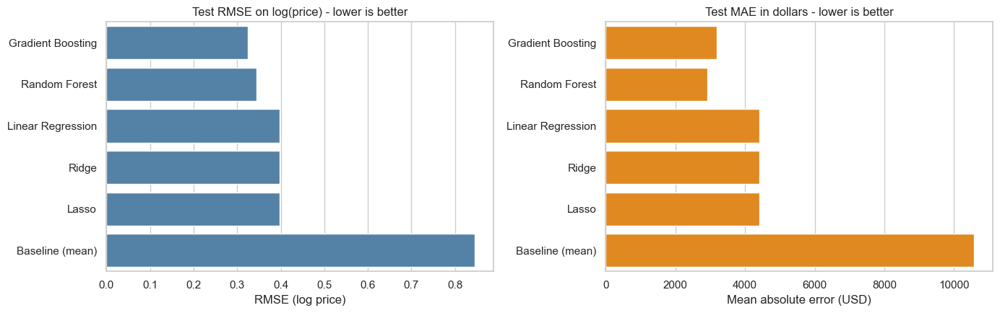
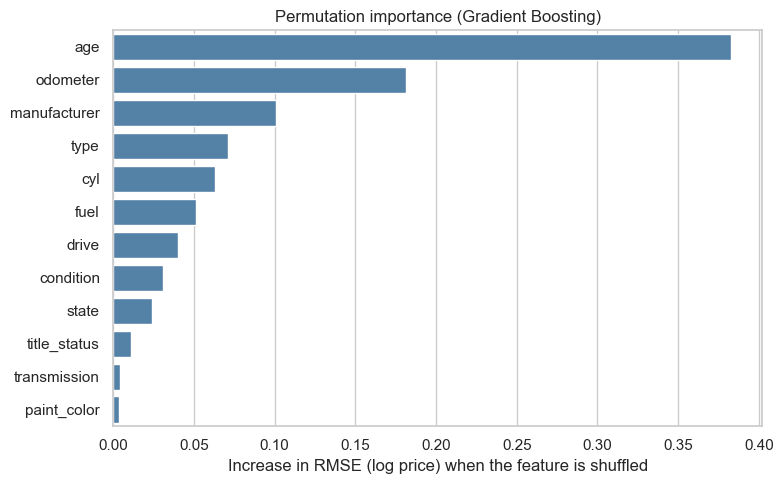
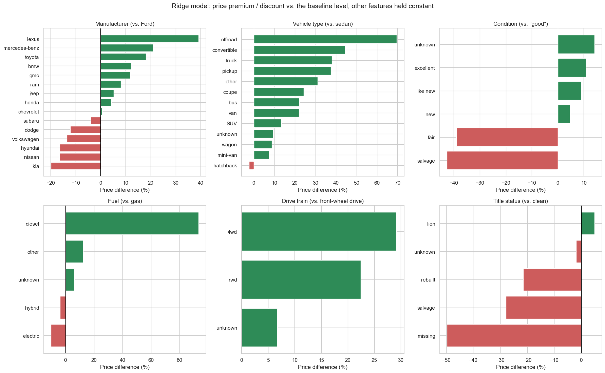

# What Drives the Price of a Used Car?

Analysis of 426,880 used-car listings to find out which vehicle attributes make a car more or less expensive, with recommendations for a used car dealership. The work follows the CRISP-DM framework (business understanding, data understanding, data preparation, modelling, evaluation, deployment).

**Notebook:** [`used_car_price_analysis.ipynb`](used_car_price_analysis.ipynb)

## Business question

A used car dealership wants to know what consumers value in a used car so it can fine-tune its inventory. We treat this as a supervised regression problem: predict the listing price from vehicle attributes, then use the models to explain which attributes move price the most.

## Data

`data/vehicles.csv` is a Kaggle used-car dataset (426,880 listings, 18 columns). It contains price, year, manufacturer, model, condition, cylinders, fuel, odometer, title status, transmission, drive, type, colour, state and region.

**Cleaning (241,193 listings kept):** removed identifier-like or unusable columns (`id`, `VIN`, `region`, `model`, `size`); kept prices from $1,000 to $100,000, odometer 100-400,000 miles and model years 1995 or newer; dropped duplicate listings; created `age` and numeric `cyl`; filled missing categories with `unknown`; modelled `log(price)`.

## Modelling

Five regression models were compared with a 80/20 train/test split, grid search and cross-validation: Linear Regression, Ridge, Lasso, Random Forest and Histogram Gradient Boosting (plus a mean-only baseline).

**Evaluation metric:** RMSE on log(price), so that errors are percentages rather than dollars that are dominated by expensive cars. MAE in dollars and R² are reported alongside.

| Model | Test RMSE (log price) | Test MAE ($) | R² |
|---|---|---|---|
| Baseline (mean) | 0.846 | 10,584 | 0.00 |
| Linear / Ridge / Lasso | 0.398 | about 4,400 | 0.78 |
| Random Forest | 0.344 | 2,917 | 0.83 |
| **Gradient Boosting** | **0.325** | 3,179 | **0.85** |

The selected model's median prediction error is 14.5%, and 72% of predictions are within 25% of the actual asking price.



## Key findings

1. **Age and mileage matter most.** Each extra year of age is associated with about 7% lower price and each extra 10,000 miles with about 4% lower price. Age is roughly twice as influential as mileage.
2. **Vehicle type, manufacturer and drivetrain come next.** Compared with a Ford sedan (same age, mileage and other features): pickups and trucks about +38%, 4WD +29%, diesel +93%, Lexus +39%, Mercedes-Benz +21%, Toyota +18%; Kia, Nissan and Hyundai are 16-20% lower.
3. **Condition and title status carry penalties.** Salvage and rebuilt titles are 28% and 22% lower; "fair" and "salvage" condition are 39% and 43% lower; "excellent" and "like new" are only about 9-11% above "good".
4. **Paint colour and transmission matter very little** once the other features are known.





## Recommendations for the dealership

* Buy newer, lower-mileage cars where the acquisition price allows; use about -7% per year and -4% per 10,000 miles as a rule of thumb.
* Stock more pickups/trucks, 4WD and diesel vehicles and well-regarded brands, after checking that purchase costs do not already absorb the premium.
* Avoid or heavily discount salvage/rebuilt titles and cars in fair condition.
* Always list title status, condition, drive train and fuel type in each ad.
* Do not pay extra for paint colour or transmission type.
* Use the model as a price sanity check (typical error about 14%; less reliable under $5,000), not as the final price.

## Limitations and next steps

The data are asking prices from online listings, not final sale prices, and the coefficients show association, not cause. Next steps: validate against the dealership's own sales, add the cleaned vehicle `model` and trim level, add listing date and description text, study seasonal and regional effects, and turn the model into a simple pricing tool.

## Repository structure

```
used-car-price-drivers/
├── README.md
├── used_car_price_analysis.ipynb   # full analysis, CRISP-DM structure, findings report at the end
├── data/
│   └── vehicles.csv                # used-car listings (Kaggle)
└── images/                         # figures used in the notebook and this README
```

## How to run

Requires Python 3.9+ with `pandas`, `numpy`, `scipy`, `scikit-learn`, `seaborn` and `matplotlib`. Open the notebook from the repository root (so that `data/vehicles.csv` is found) and run all cells; it takes about 8 minutes, mostly for the grid searches.
